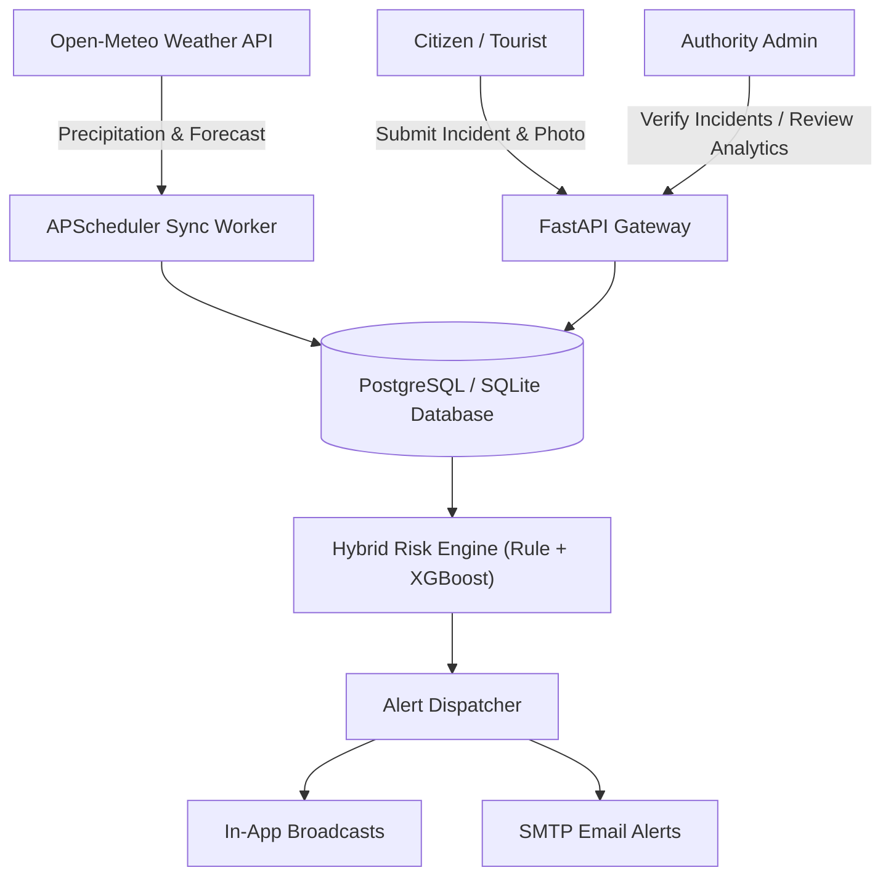

# HimalayaSense — Early-Warning & Citizen-Reporting Decision-Support System

HimalayaSense is a web-based early-warning and citizen-reporting platform for landslides, flash-floods, and unsafe road corridors in Uttarakhand, India, piloted in Dehradun district.

---

## 1. Problem Statement

Uttarakhand regularly experiences monsoon-triggered cloudbursts, debris flows, landslides, and flash floods that disrupt highway lifelines, strand commuters and pilgrims, and threaten valley settlements. Official state advisories are often high-level and lack granular ward/corridor granularity. HimalayaSense bridges this gap with hyper-local weather ingestion, hybrid rule and ML risk engines, and participatory citizen reporting.

---

## 2. Key Features

- **Interactive Risk Map**: Real-time Leaflet visualization of Dehradun risk zones categorized by risk levels (Green, Yellow, Orange, Red).
- **Automated Weather Ingestion**: Continuous tracking of precipitation, temperature, humidity, and 72-hour forecasts via Open-Meteo API.
- **Participatory Citizen Incident Reporting**: Citizens can log landslides, flash-floods, and road blockages with GPS coordinates, description, and photographs.
- **Incident Verification Workflow**: Authorities review, verify, set in-progress, or resolve incidents with official notes.
- **Hybrid Risk Engine**: Transparent multi-factor rule engine coupled with an XGBoost ML classifier prioritizing safety recall.
- **Deduplicated Emergency Alerts**: In-app broadcasts and SMTP alerts triggered for Orange/Red levels with a 6-hour suppression window.
- **Authority Analytics**: Key performance indicators, resolution timelines, category breakdowns, and rainfall-incident correlation charts.

---

## 3. Architecture



---

## 4. Tech Stack

- **Backend Framework**: Python FastAPI (typed, modular)
- **Database**: PostgreSQL (Production) / SQLite (Development Fallback)
- **ORM & Migrations**: SQLAlchemy 2.0 & Alembic
- **Authentication**: JWT (OAuth2PasswordBearer, Bcrypt)
- **Machine Learning**: Scikit-Learn, XGBoost, Pandas, NumPy, Joblib
- **Weather Services**: Open-Meteo Forecast & Historical APIs
- **Task Scheduling**: APScheduler
- **Testing**: Pytest & Pytest-Cov (>80% coverage)

---

## 5. Local Setup Instructions

### Prerequisites
- Python 3.10+ (tested on Python 3.14)
- Git
- Docker (optional for PostgreSQL container)

### 1. Clone & Environment Setup
```bash
git clone https://github.com/your-org/himalayasense.git
cd himalayasense

# Activate virtual environment
# Windows:
.\.venv\Scripts\activate
# Linux/macOS:
source .venv/bin/activate

# Install dependencies
pip install -r backend/requirements.txt
```

### 2. Environment Variables Configuration
Copy `.env.example` to `.env`:
```bash
# Windows
copy .env.example .env
copy backend\.env.example backend\.env

# Linux/macOS
cp .env.example .env
cp backend/.env.example backend/.env
```

### 3. Run Database Migrations
```bash
cd backend
alembic upgrade head
cd ..
```

### 4. Seed Demo Data
Populates 8 Dehradun zones, admin/citizen accounts, 7-day weather logs, 21 incidents, and sample alerts:
```bash
# Windows PowerShell
$env:PYTHONPATH="backend;.backend"; python backend/seed.py

# Linux/macOS
PYTHONPATH=backend python backend/seed.py
```

### 5. Start Backend Server
```bash
# From repository root
uvicorn app.main:app --app-dir backend --host 127.0.0.1 --port 8000 --reload
```
Interactive Swagger API documentation: [http://localhost:8000/docs](http://localhost:8000/docs)

---

## 6. Seed Credentials (Local Development)

| Role | Email | Password |
|---|---|---|
| **Admin** | `admin@himalayasense.local` | `Admin@12345` |
| **Citizen 1** | `citizen@himalayasense.local` | `Citizen@12345` |
| **Citizen 2** | `priya.rawat@himalayasense.local` | `Citizen@12345` |

---

## 7. Running Tests & Coverage

```bash
# Run pytest with code coverage
$env:PYTHONPATH="backend;.backend"; pytest backend/app/tests --cov=app --cov-report=term-missing
```
*Current coverage: 83% across 33 passing test suites.*

---

## 8. Machine Learning Model

- **Model Type**: XGBoost Binary Classifier (`app/ml/models/risk_model.joblib`)
- **Metric Priority**: High **Recall** (0.7907) to avoid missing severe hazards
- **Features Used**:
  - `rainfall_last_3h`, `rainfall_last_24h`, `rainfall_last_72h`, `forecast_rainfall_24h`, `max_hourly_rainfall`
  - `slope`, `elevation`, `distance_to_river`, `road_density`
  - `historical_incident_count`, `active_verified_reports`
- **Training Script**: `python backend/app/ml/train_model.py`

---

## 9. Limitations & Disclaimer

- **Decision Support**: This platform is an educational decision-support tool, not an official replacement for advisories from the India Meteorological Department (IMD) or the Uttarakhand State Disaster Management Authority (USDMA).
- **Synthetic Historical Incident Records**: Because real incident records from local police/PWD lack open GIS feeds, the ML training dataset was generated using simulated geomorphological distributions clearly marked in `data/sample/synthetic_landslide_data.csv`.

---

## 10. Future Scope

- Integration with ISRO Bhuvan satellite DEM layers and Geological Survey of India (GSI) landslide hazard maps.
- Push notifications via WhatsApp Business API and SMS gateway (NDMA CAP compliant).
- Real-time crowdsourced road blockage routing for Google Maps or Mapbox navigation.
