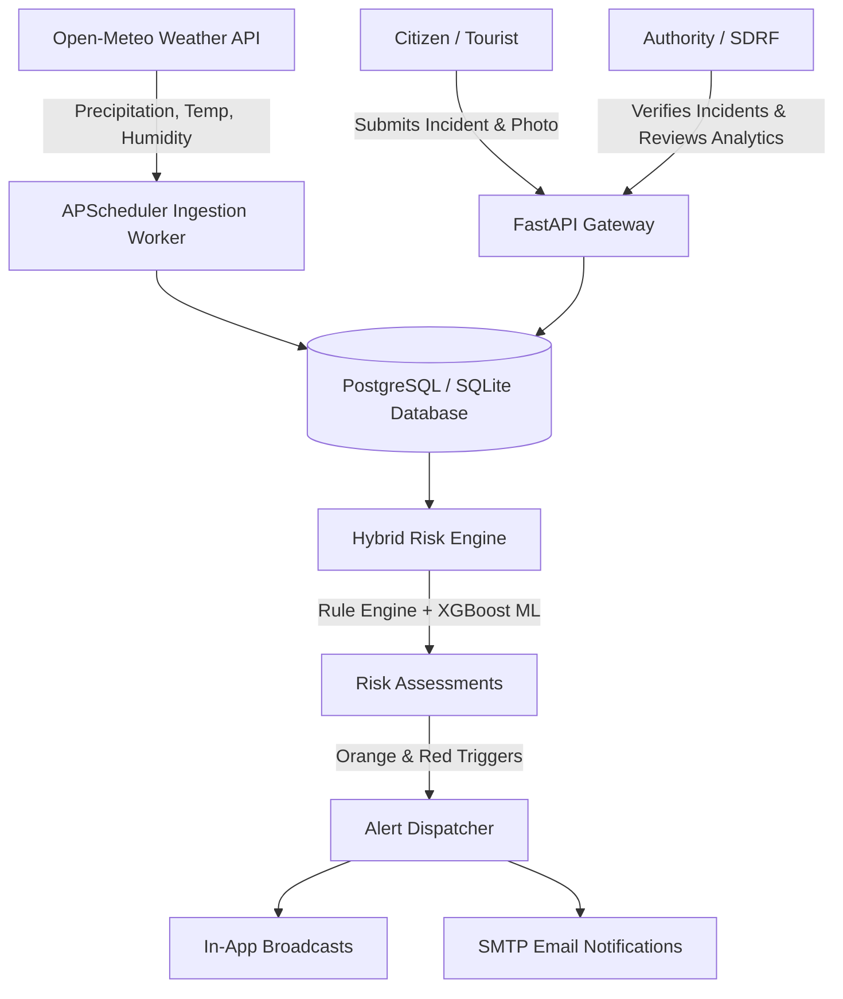

# HimalayaSense Architecture

## 1. System Overview

HimalayaSense is a decision-support and early-warning platform for monitoring and mitigating disaster risks (landslides, flash-floods, road blockages) across the mountainous terrain of Uttarakhand, piloting in Dehradun district.



## 2. Core Subsystems

### Ingestion Subsystem
- Fetches 3-day precipitation, temperature, relative humidity, and wind speed forecasts from Open-Meteo hourly endpoints.
- Auto-retries up to 3 times with exponential backoff.
- Stores historical readings and updates zone forecast values every 30 minutes.

### Hybrid Risk Scoring
- **Stage 1 (Rule-Based)**: Evaluates a 5-factor weighted score:
  `0.40 * rain_24h + 0.25 * forecast_24h + 0.15 * terrain + 0.10 * past_history + 0.10 * active_verified_reports`.
- **Domain Overrides**:
  - >= 2 verified landslides -> Minimum Orange risk.
  - >= 3 verified flash-floods -> Minimum Orange risk.
  - Forecast precipitation > 70 mm -> Minimum Red emergency risk.
  - Low terrain susceptibility (< 0.35) -> 15% terrain mitigation buffer.
- **Stage 2 (Machine Learning)**: XGBoost classifier trained on time-ordered meteorological and geomorphological data, prioritizing Recall (0.79+) to prevent missed disaster events.

### Incident Workflow
```text
submitted -> verified -> in_progress -> resolved
                    -> rejected
```
- Coordinates are validated and reverse-geocoded/matched to zone polygons via ray-casting.
- High-severity verified incidents escalate zone alerts and trigger immediate risk recalculation.

### Alert Subsystem & Deduplication
- 6-hour suppression window to prevent notification spamming per zone.
- Alerts bypass the window if the risk escalates to a higher severity level.
